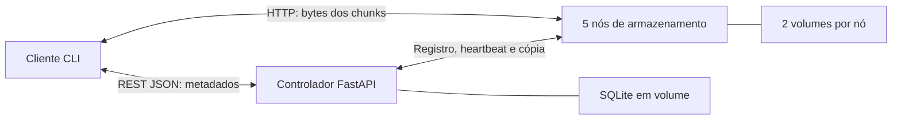

# DComp Drive
## Relatório técnico · Parte 1

**Universidade Federal de Sergipe** 
**Sistemas Distribuídos · COMP0470** 
**Professor:** Rafael Oliveira Vasconcelos 
**Equipe:** Raissa Cavalcante, Amaro e Fábio Lisboa 
**Data:** 18 de novembro de 2026

### 1. Objetivo e arquitetura

O DComp Drive armazena arquivos em blocos replicados. O cliente envia e lê os bytes diretamente nos nós de armazenamento. O controlador decide onde as réplicas ficam, mantém os metadados e coordena a recuperação. Essa separação reduz o tráfego de dados no controlador e permite adicionar nós sem alterar o código do cliente.

<!-- architecture -->

| Componente | Responsabilidade |
|---|---|
| Cliente | Comandos de arquivo e diretório, divisão em chunks, SHA-256, cifra opcional e transferência. |
| Controlador e nó de metadados | Árvore de arquivos, versões, leases, quóruns, discos elegíveis e coordenação da re-replicação. |
| Nós de armazenamento | Gravação e leitura de chunks, verificação de integridade, cópia entre nós, registro e heartbeat. |

O ambiente de demonstração usa um controlador e cinco nós no Docker Compose, com dois volumes de dados por nó. O controlador usa SQLite em modo WAL num volume separado. Os contêineres compartilham o host físico.

<!-- page -->

### 2. Protocolo e operações

O plano de controle usa REST com JSON. Cada chunk é identificado por UUID; cada disco, por um identificador como `node1/disk1`. O plano de dados usa HTTP com corpo binário `application/octet-stream`.

| Operação | Contrato resumido |
|---|---|
| Alocação | `POST /files/allocate` recebe caminho, tamanho armazenado, quantidade de chunks e N opcional. Retorna lease, versão prevista e destinos por chunk. |
| Dados | `PUT /chunks/{id}` recebe bytes, disco e SHA-256 esperado. `GET /chunks/{id}` serve bytes verificados e o cabeçalho `X-Chunk-Hash`. |
| Commit | `POST /files/commit` recebe lease, hash do arquivo, hashes e tamanhos dos chunks e discos confirmados. Retorna o estado do arquivo. |
| Localização | `GET /files/locate` retorna os chunks da versão visível e as réplicas alcançáveis pelo cliente. |
| Registro e heartbeat | `POST /nodes/register` recebe identidade, endereço e discos. `POST /nodes/{id}/heartbeat` atualiza capacidade, uso e último sinal. |
| Cópia e denúncia | `POST /chunks/{id}/copy` indica discos de origem e destino e a URL de destino; `POST /chunks/corrupt` indica o chunk e o disco afetados. |

**Escrita.** O cliente parte o arquivo em chunks de 4 MiB por padrão, eventualmente cifra e calcula os hashes. Após alocar os destinos, grava cada chunk em paralelo nas suas réplicas. Só envia o commit quando cada chunk obtém o quórum W. O controlador valida as confirmações contra os discos da alocação e publica a versão em uma transação.

**Leitura.** O cliente consulta a localização, tenta as réplicas disponíveis e verifica o hash de cada chunk. Se houver falha ou corrupção, segue para outra cópia. Também confere o hash do arquivo e só substitui o destino local após validar o conteúdo completo.

**Operações e mensagens.** O CLI oferece `put`, `get`, `ls`, `stat`, `mv`, `rm`, `mkdir`, `rmdir`, `status` e `drain`. HTTP 409 indica conflito, como um lease ativo; 422 indica dados ou hash inválidos; 507 indica falta de capacidade ou quórum. Os formatos completos estão em `docs/endpoints.md`.

<!-- page -->

### 3. Replicação e resiliência

**Posicionamento.** A configuração inicial usa N = 3 réplicas e W = 2 confirmações por chunk. Discos ativos com maior espaço livre têm prioridade; discos com uso igual ou superior ao limite de 90% ficam de fora. O controlador procura uma máquina por cópia. Quando faltam máquinas, pode completar N usando discos diferentes de um mesmo nó e informa essa concentração na alocação.

**Falta de destinos.** Se houver menos de N discos elegíveis, `accept` admite a escrita quando o quórum é possível, e o arquivo pode ficar sub-replicado. A opção `reject` rejeita essa alocação. Com menos de W confirmações, a escrita não é publicada. O estado `intact` indica N cópias; em discos de um mesmo nó, ele não implica N máquinas independentes.

| Evento | Reação do sistema |
|---|---|
| Suspeita e falha | Heartbeats a cada 3 s. Após 6 s sem sinal, o nó fica suspeito. Aos 10 s, o controlador declara a falha e marca como perdidas as cópias daquele nó. |
| Re-replicação | Prioriza chunks com menos fontes vivas. Uma fonte verificada envia os bytes diretamente ao destino. O controlador conta a nova cópia só após confirmação. Limite padrão de duas cópias simultâneas e uma por arquivo. |
| Retorno | O nó se registra novamente. O controlador compara o inventário com seus metadados, reaproveita cópias íntegras quando necessárias e agenda a exclusão das obsoletas. |
| Retirada planejada | `drain` bloqueia novas alocações no nó e mantém as leituras. Com N cópias fora dele e nenhuma exclusão pendente, o nó pode ser retirado. |

**Observabilidade.** `/status` expõe nós, discos, estados dos arquivos e cópias em andamento. `/metrics` informa contagens e tempos; os nós expõem latências, volume em bytes e resultados do scrubbing. O CLI, o controlador e os nós registram eventos JSON com horário e identificação da operação.

O tempo de detecção é contado desde o último heartbeat. O tempo de recuperação mede a espera após o nó ser declarado morto. Se a reposição termina enquanto ele ainda está suspeito, essa espera é zero.

<!-- page -->

### 4. Consistência, integridade e limites

**Concorrência e persistência.** Um lease por caminho impede escritores simultâneos. Versões em preparo ficam nas tabelas de staging; leitores continuam vendo a versão anterior. O SQLite promove os metadados do arquivo e seus chunks em uma transação, após validar W. Ao expirar um lease, as cópias incompletas são retiradas do staging e a limpeza física segue uma fila persistente.

**Consistência e CAP.** A escolha é dar consistência à versão confirmada nos metadados. O controlador único evita versões concorrentes do catálogo. Se um cliente perde contato com ele, não consegue concluir um commit nem consultar uma localização nova. A leitura ainda depende de uma réplica íntegra acessível de cada chunk, e as cópias restantes são repostas de forma assíncrona.

**Integridade e cifra.** SHA-256 é calculado sobre os bytes armazenados. O nó verifica na gravação, na leitura e no scrubbing; uma divergência leva à quarentena e à denúncia ao controlador. Com cifra ligada, o cliente usa AES-256-GCM e a chave de 32 bytes em `DRIVE_KEY`. Cada chunk tem prefixo `DCDRIVE1`, nonce de 12 bytes e tag de 16 bytes, somando 36 bytes de sobrecarga. O AAD vincula a cifra ao UUID e ao índice; controlador e nós não recebem a chave.

| Limite | Implicação |
|---|---|
| Controlador único | O catálogo sobrevive ao reinício com o volume, mas a API de metadados para durante a falha. A perda do volume exige backup; não há eleição de líder. |
| Domínios de falha | Duas cópias em um nó podem ser perdidas juntas. Os volumes do Compose não protegem contra a perda do host compartilhado. |
| Leases e leitura longa | O TTL deve comportar a escrita; não há renovação de lease. Versões substituídas retêm chunks por 60 s, o que limita leituras antigas mais longas. |
| Escala | A escala exercitada é de cinco nós. Capacidade máxima, concorrência e vazão sustentada ficam para a Parte 2; SQLite, CPU, disco e rede são candidatos a gargalo. |

<!-- page -->

### 5. Validação, entrega e equipe

A validação distingue a execução no Codespace da execução local com nós em processos separados. A base da `main` foi o commit `5d2fe32`; a revisão de entrega acrescenta as correções da métrica e do roteiro de corrupção.

| Evidência | Resultado |
|---|---|
| Suíte automatizada da revisão | 81 testes passaram. A suíte cobre CLI, cifra, corrupção, leases, versionamento, replicação e recuperação. |
| Queda e retorno no Compose (Codespace) | Após parar o `node1`, o sistema repôs três réplicas com SHA-256 correto. O nó voltou a `alive` e os cinco ficaram ativos. Detecção: 10,644 s após o último heartbeat nessa execução. |
| Métrica na revisão | A execução anterior ao ajuste retornou `None` para tempo de recuperação. O teste local da revisão reproduziu a cópia durante a suspeita e registrou 0,0 s de espera após a declaração de falha. |
| Drain e corrupção com cinco nós locais | Um nó foi esvaziado mantendo três destinos ativos. A réplica alterada retornou HTTP 422, o controlador repôs a cópia e o arquivo baixado continuou igual ao original. |

| Integrante | Escopo |
|---|---|
| Raissa Cavalcante · Pessoa A | Metadados, transações SQLite, posicionamento, versionamento, leases e quórum. |
| Amaro · Pessoa B | Nós de armazenamento, cliente CLI, transferência, hash, cifra e scrubbing. |
| Fábio Lisboa · Pessoa C | Compose, registro, heartbeat, detecção de falhas, re-replicação, reconciliação, drain e roteiro de falhas. |

**Reprodução.** O `README.md` descreve a instalação e os comandos. O roteiro em `docs/demo-parte1.md` reúne upload, download, queda de nó e corrupção para gravação ou apresentação ao vivo. O procedimento da Parte 2 começa com a identificação da versão testada por uma tag do Git.

**Referências do projeto.** Enunciado em `02_dcomp_drive.txt`; contratos em `docs/endpoints.md`; contribuições e evidências em `docs/relatorio_pessoa_a.md`, `docs/relatorio_pessoa_b.md` e `docs/resiliencia.md`; histórico em `github.com/luanorama/dcomp-drive`.
